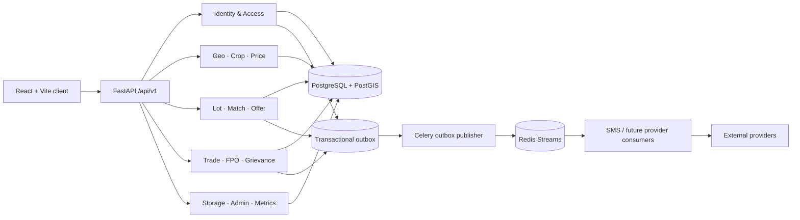

# Work Packet 01 — Architecture and Domain Contracts

Date: 2026-09-17  
Branch: `abdulrehman`  
Status: Implementation record is in `01-result.md`.

## 1. Architecture decision

KrishiLink remains a **modular monolith**: one FastAPI application, one SQLAlchemy persistence layer, and one PostgreSQL/PostGIS database, split into bounded contexts with clear ownership of writes. Redis/Celery serve asynchronous delivery, not as the source of business truth. The React/Vite client remains client-rendered. This is the smallest architecture consistent with the current working system and Packet 00 evidence; no service split, rendering-framework migration, or schema rewrite is justified here.

Redis is a delivery/coordination dependency. User, offer, reservation, trade, audit and event records remain authoritative in the database. Provider availability must not mutate committed trade facts.

## 2. Bounded contexts and ownership

One database is acceptable initially. The table below assigns the write boundary and records what the code actually implements. A module may query another context’s published/read data; it must not silently take ownership of another context’s lifecycle.

| Bounded context | Current code/evidence | Write ownership and boundary |
|---|---|---|
| Identity & Access | `modules/auth`, `User`, farmer/buyer/FPO profiles, `core/security.py` | Accounts, credentials, sessions and role identity. Auth service owns identity changes. Verification dimensions are not yet modeled independently. |
| Geography & Outlets | `modules/markets`, `Market`, `StorageFacility.location_geog` | Market directory and persisted locations. `markets` currently combines APMC data and map projections; no canonical outlet/provenance context yet. |
| Crops / Quality Catalogue | `modules/crops`, `Crop`, `CropVariety` | Crop IDs/names/units and varieties. Quality specifications/case lifecycle are not implemented. |
| Market Intelligence / Prices | `modules/prices`, `PriceObservation`, `PriceSource` | Dated, sourced price observations and sync metadata. Treat market directory as a referenced context, not mutable price-owned data. |
| Listings / Lots | `modules/lots`, `Lot`, `LotAllocation` | Seller-owned commodity offers to market, published quantities and lot state. Creation currently publishes directly; a full draft/publish transition API is absent. |
| Matching / Requirements | `modules/matching`, `BuyerRequirement`, `Match`, `MatchRuleSet` | Requirements and explainable match projections. Matching reads lots, profiles and requirements; it does not own offer acceptance or trade state. |
| Offers / Negotiation | `modules/offers`, `Offer` | Offer/counter chain and accept/decline outcomes. Acceptance currently creates reservation and transaction in the same application operation; this cross-context orchestration is recorded as compatibility debt. |
| Trades / Fulfilment | `modules/transactions`, `modules/trades`, `Transaction`, `Reservation`, `TradeTermSnapshot`, `TradeEvent` | Transaction/trade aggregate, participant authorization, immutable agreed-term snapshot and timeline. Two routes remain, but now share a lifecycle graph. |
| Logistics | `Delivery` model and trade-room projection; no dedicated router/service | Own delivery planning, dispatch evidence and carrier updates when implemented. Trade state may reference delivery status but must not invent carrier data. |
| Storage | `modules/storage`, `StorageFacility` | Facility directory only. No storage booking aggregate or booking lifecycle exists. |
| Payments / Settlement Tracking | `Payment` model and sandbox-labeled trade-room summary | Own payment attempt/reference and settlement evidence when implemented. No real provider interface, callback route or payment transition service exists. A Trade status is not proof of payment. |
| FPO Aggregation / Payout Allocation | `modules/fpo`, `FPOProfile`, `FPOMember`, `Lot` | FPO membership, member contributions and pooled lot creation. Member payout allocation/reconciliation is not implemented. An FPO is an organization boundary, not a global role grant. |
| Trust / Verification | `User.is_verified`, `BuyerProfile.is_verified`, admin verify route | Current booleans are coarse state only. No trust score or verification case aggregate exists. Do not present a generic flag as multiple verified dimensions. |
| Disputes / Grievances | `modules/disputes`, `Dispute`, `Evidence` | Case, evidence, resolution and allowed case transitions. Admin/operator state mutation is now graph-checked. |
| Notifications | `modules/notifications`, `Notification`, `OutboxEvent`, `workers/celery_app.py` | Persistent in-app notifications plus asynchronous side-effect intents. Delivery attempt/provider receipt should be separate from domain success. |
| Reporting / Metrics | `modules/metrics`, admin reporting endpoints | Read-only projections over owning contexts. Metrics cannot create authoritative buyer/trade/verification facts. |
| Admin / Moderation / Data Operations | `modules/admin`, admin routes in disputes and notifications | Privileged operational actions with actor/audit evidence. Admin bypasses party-level access where intended, never domain state validity. |

### Dependency direction

- Identity authenticates the actor; domain services authorize the actor against aggregate ownership/participation.
- Matching consumes read projections from Lots, Requirements, Crops and persisted location data.
- Offers may request a trade creation as part of acceptance, but the Trade context owns the resulting transaction lifecycle and immutable snapshot.
- Trade references Payment, Logistics, Storage and Grievance outcomes; those contexts own their separate records and state transitions.
- Notifications consume committed outbox events. A provider result cannot retroactively change a Lot, Offer or Trade without a validated command.
- Reporting reads published records and never manufactures domain state.

## 3. Lifecycle contracts

All state names are normalized uppercase in application transitions. The canonical current graphs for Trade and Grievance are enforced by `backend/app/core/domain_contracts.py`; role authorization remains a separate check. Unknown and terminal states fail closed with HTTP 409.

### Lot

Contract: `DRAFT -> PUBLISHED`; `PUBLISHED -> PARTIALLY_ALLOCATED | RESERVED | SOLD | EXPIRED | CANCELLED`; `PARTIALLY_ALLOCATED -> PARTIALLY_ALLOCATED | RESERVED | SOLD | EXPIRED | CANCELLED`; `RESERVED -> PARTIALLY_ALLOCATED | SOLD | EXPIRED | CANCELLED`. `SOLD`, `FULFILLED`, `EXPIRED` and `CANCELLED` are terminal. Existing implementation creates lots as `PUBLISHED`; allocation/offer operations do not yet expose a single complete lot transition service. This is a documented enforcement gap, not a new lot workflow in Packet 01.

### Offer / negotiation

Contract: `PENDING -> COUNTERED | ACCEPTED | REJECTED | EXPIRED | CANCELLED`; `COUNTERED -> ACCEPTED | REJECTED | EXPIRED | CANCELLED`. Countering creates a child offer linked by `parent_offer_id`; the parent is not revived. Accepted/rejected/expired/cancelled offers are terminal. Current endpoints check pending/negotiable states procedurally; expiry and cancellation orchestration are incomplete and must not be inferred from the timestamp alone.

### Trade / fulfilment

| Current state | Allowed next states |
|---|---|
| `CREATED` | `PAYMENT_PENDING`, `PAYMENT_CONFIRMED`, `CANCELLED`, `DISPUTED` |
| `PAYMENT_PENDING` | `PAYMENT_CONFIRMED`, `CANCELLED`, `DISPUTED` |
| `PAYMENT_CONFIRMED` | `PROCESSING`, `READY_FOR_DISPATCH`, `CANCELLED`, `DISPUTED` |
| `PROCESSING` | `READY_FOR_DISPATCH`, `CANCELLED`, `DISPUTED` |
| `READY_FOR_DISPATCH` | `IN_TRANSIT`, `CANCELLED`, `DISPUTED` |
| `IN_TRANSIT` | `DELIVERED`, `DISPUTED` |
| `DELIVERED` | `COMPLETED`, `DISPUTED` |
| `DISPUTED` | `COMPLETED`, `CANCELLED`, `REFUNDED` |
| `COMPLETED`, `CANCELLED`, `REFUNDED` | none |

The graph merges the two established API vocabularies while preserving existing flows (including direct sandbox-confirmation transitions and the `CREATED -> PAYMENT_PENDING` transaction flow). `POST /transactions/{id}/transition` and `POST /trades/{id}/transition` must both use it. Admin/operator role does not permit skipping lifecycle states; only admin/operator may record `REFUNDED`. Trade resolution is expressed by the linked Grievance lifecycle, not a `RESOLVED` trade state (the DB constraint does not allow that trade status). Payment-confirmed or completed state in this sandbox workflow is not a real bank settlement claim.

### Storage booking (future contract; no booking model/API)

`REQUESTED -> CONFIRMED | REJECTED | CANCELLED`; `CONFIRMED -> CHECKED_IN | CANCELLED`; `CHECKED_IN -> CHECKED_OUT | DISPUTED`; `CHECKED_OUT`, `REJECTED`, `CANCELLED` and `DISPUTED` are terminal pending an explicit resolution workflow. Capacity reservation and cancellation must be transactional before this graph is activated.

### Verification case (future contract; no case aggregate)

`PENDING -> IN_REVIEW | NEEDS_INFORMATION | APPROVED | REJECTED`; `IN_REVIEW -> NEEDS_INFORMATION | APPROVED | REJECTED`; `NEEDS_INFORMATION -> PENDING | IN_REVIEW | WITHDRAWN`; `APPROVED`, `REJECTED`, `WITHDRAWN` are terminal unless a new case/version is created. Identity, GST, bank and business checks are separate dimensions; a provider callback or admin action must be auditable.

### Grievance

`OPEN -> UNDER_REVIEW | RESOLVED | REJECTED | ESCALATED`; `UNDER_REVIEW -> RESOLVED | REJECTED | ESCALATED`; `ESCALATED -> UNDER_REVIEW | RESOLVED | REJECTED`; `RESOLVED` and `REJECTED` are terminal. Direct `OPEN -> RESOLVED` is retained for the existing admin workflow. Unknown statuses and reopening a terminal case return 409.

### Provider payment and notification attempts (future separate attempt records)

`PENDING -> SUBMITTED | FAILED`; `SUBMITTED -> SUCCEEDED | FAILED | UNKNOWN`; `UNKNOWN -> SUCCEEDED | FAILED | MANUAL_REVIEW`; `FAILED -> RETRY_WAIT | MANUAL_REVIEW`; `RETRY_WAIT -> SUBMITTED`; terminal outcomes are `SUCCEEDED` and `MANUAL_REVIEW`. Provider retries use an idempotency key and bounded exponential backoff. `SUCCEEDED` requires authenticated provider evidence; a timeout is `UNKNOWN`, never a fabricated failure or success. Notification delivery status is not transaction status.

Current implementation has an OutboxEvent `PENDING/COMPLETED/FAILED` processing flag and a Payment row status string, but no general attempt FSM/provider callback path. These future transitions are contracts only and are not represented as executable capabilities yet.

## 4. API, identifier and event conventions

### HTTP API

- Public API namespace: `/api/v1`; publish the generated OpenAPI schema outside production. `/metrics` is an explicitly internal operational exception and remains outside that public namespace.
- Preserve successful envelope `{success, data, message, request_id}` and `X-Request-ID`. Existing exception shape is inconsistent; new/changed endpoints should use the same request ID and a stable machine-readable error code while retaining HTTP semantics.
- Collections use `page` (1-based), `limit` (bounded), and response fields `items`, `total`, `page`, `limit`, `pages`. Filters and sorts are allow-listed and URL-shareable; never pass raw sort expressions into SQL.
- Use 401 unauthenticated, 403 authenticated but unauthorized, 404 absent/non-disclosable, 409 invalid lifecycle/conflict, 422 invalid input, 429 rate limit, and 5xx unexpected/external failure. Avoid `success: true` for degraded provider behavior.
- Breaking public contract changes require a versioned route or documented deprecation window, updated OpenAPI, frontend contract tests, and removal only after consumers migrate.
- Consequential POST operations support scoped idempotency. A replay returns the original result only for the same actor/operation/key; idempotency and domain mutation should be committed atomically. Current helper scope and operation coverage are incomplete and remain a follow-up.
- Provider webhooks require signature verification, timestamp/replay window, durable receipt/idempotency record, and audit before dispatching state changes. No webhook endpoints are introduced here.

### IDs

- Internal relational primary keys stay UUIDs and remain private implementation identifiers where a public projection exists.
- Preserve existing `KL-LOT-*` and `KL-TRD-*` values as public references. Continue returning UUID `id` fields for current-client compatibility; new external links, receipts and notifications prefer the public reference.
- New public IDs must be unpredictable, unique in the database, non-sequential, and tested for collision handling. Do not rely on a truncated random string alone as a uniqueness guarantee.
- Foreign keys and event payloads may use internal UUIDs within the trusted backend boundary. Public APIs must authorize each ID lookup; opacity never replaces authorization.

## 5. Transactional outbox decision

The database commit is the boundary between a domain fact and a side effect. Insert the aggregate mutation, audit entry and outbox event in one transaction. Rollback means none are committed. A worker claims a bounded batch, publishes an event with immutable `event_id`, and records delivery progress. Consumers deduplicate by that ID because a crash after publish and before database acknowledgment may deliver twice. Retries are bounded exponential backoff; exhausted events become a visible dead-letter/manual-review condition with metrics and redacted diagnostics.

The existing row lock with `skip_locked` is retained. Redis Streams are transport, not the only durable record. Provider adapters must be idempotent or use provider idempotency keys. Sensitive credentials, reset tokens and unnecessary personal data do not enter event payloads. No broker/schema migration is required for this contract.

## 6. Provider-interface convention

Provider-specific SDK calls remain behind backend-owned adapters. An adapter accepts a typed request with domain reference, idempotency key and only minimum necessary personal data; returns normalized `accepted`, `pending`, `succeeded`, `failed` or `unknown`, plus provider name/reference, safe reason code and timestamps. Raw provider payloads are retained only where needed, encrypted or access-controlled and redacted from logs. An accepted/queued response is not a delivered, verified or settled outcome. In tests use deterministic fakes; production configuration must fail closed when a required provider is absent.

Current SMS integration is a static `SMSService` with several provider branches. Payment has a persistence model but no provider protocol. No provider-interface refactor is made in Packet 01; future modules should depend on the contract above rather than on provider SDKs.

## 7. Rendering-stack ADR

**Decision:** retain React + Vite + React Router client rendering.

The Packet 00 baseline has a passing frontend build and route chunks; the latest frontend Docker path now serves a static production build. There is no measurement that proves SSR is required. Keep route-level lazy loading and real API state handling. Reconsider SSR only after route-level crawlability, measured first contentful render, or an agreed SEO target fails under this stack and an SSR benchmark demonstrates a material improvement without compromising low-bandwidth/mobile UX. No stack migration or UI redesign is part of Packet 01.

## 8. Offline and conflict ADR

**Decision:** permit resilient local drafts and truthful stale reads; do not add background replay for consequential mutations.

The existing app only detects offline state; it has no service worker, durable sync queue, or conflict protocol. A future draft can record client draft ID, actor, local revision, created/updated timestamps and sync state. On reconnect, the user reviews and submits; the server validates current permissions and domain state. If server version/availability changed, return a conflict and show both versions with explicit user action. Never queue offer acceptance, payment, trade transition, verification, payout or grievance-resolution writes for silent replay. No browser storage or offline sync code is changed in this packet.

## 9. Multi-tenancy stance

**Decision:** logical account and FPO organization boundaries with application-level authorization; no database-level tenant isolation is claimed today.

Personal farmer/buyer records are scoped to their user. FPO-owned records are scoped through `FPOProfile` and membership; member access must verify the FPO relationship. Admin/support access is explicit and audited. The schema has no universal `tenant_id`, no organization-claims middleware and no row-level security policy. Keep the present single-platform deployment; before multi-institution or white-label tenancy, add organization identity, membership/role grants, tenant foreign keys, query scoping, uniqueness boundaries, and cross-tenant denial tests in a separately approved migration packet.

## 10. Acceptance evidence and remaining gaps

- Trade and grievance state graphs now have direct tests and route-level invalid-transition tests.
- Storage booking, verification case, provider attempt, and complete Lot/Offer transition orchestration have documented contracts but remain unimplemented or partially enforced; future feature packets must add server mutation APIs and invalid-transition tests before exposing those workflows.
- No new route, database table, migration, frontend behavior or provider integration was added.
